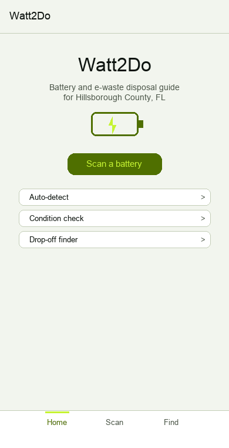
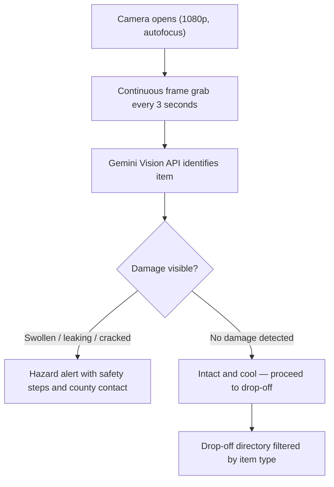

# Watt2Do

[](https://watt2do.vercel.app/)
[](https://ai.google.dev/)
[](https://developers.google.com/maps)

**Live:** [https://watt2do.vercel.app/](https://watt2do.vercel.app/)

Watt2Do is an AI-powered battery and e-waste identification assistant built for Hillsborough County, Florida. Point your camera at a battery or electronic device and the app instantly identifies the item, assesses visible damage, and routes you to a verified local drop-off facility.

---

## How it works



1. Open the **Scan** tab and point your camera at a battery or device.
2. The app scans automatically — no button press needed.
3. A condition card appears: **Intact and cool** or a hazard alert with safety steps.
4. Switch to **Find Drop-offs** to see nearby certified collection sites on the map.

---

## Features

**Automatic AI scanning**
- Continuous frame detection powered by Google Gemini Vision — zero clicks required.
- Instant Scan button for immediate analysis on demand.
- Recognizes batteries (alkaline, lithium-ion, lithium coin, lead-acid, NiMH), e-waste, and household hazardous items.

**Condition assessment**
- Detects swelling, leaks, corrosion, dents, and punctures from the camera feed.
- Surfaces emergency safety steps and the Hillsborough County Solid Waste contact number for damaged batteries.
- Returns "Intact and cool" with disposal routing when no damage is found.

**1080p HD camera controls**
- Full HD stream with continuous macro autofocus and auto-exposure.
- 1x / 2x macro zoom toggle for reading small battery text.
- Front / rear camera flip and hardware torch toggle.

**Drop-off directory**
- 21+ hand-verified facilities: Hillsborough County HHW sites, Home Depot, Best Buy, Staples, Batteries Plus, and USF EHS.
- Filter by material type (batteries, e-waste, hazardous) and open hours.
- Google Maps integration with an interactive SVG fallback if the Maps key is domain-restricted.

**Watty AI assistant**
- Chat assistant powered by Gemini for battery safety questions and disposal guidance.
- Google Sign-In via Google Identity Services with instant guest access.

---

## Architecture

```text
watt2do/
├── index.mjs          # Node.js server (port 3001) — Gemini scan, plan, chat, and dropoffs APIs
├── chat.mjs           # Watty assistant: item recognition patterns and Gemini chat integration
├── directory.mjs      # Disposal rules, drop-off locations, and advice by item type
├── vision.py          # Python/Flask Gemini integration for local development fallback
├── app.py             # Flask server (port 5001) for local testing
├── public/            # Frontend served by Node (page.html, screen.css, map.js)
├── static/            # Production static assets synced with public/ (served on Vercel)
├── docs/
│   └── demo.gif       # Animated walkthrough used in this README
└── .env.example       # Environment variable template
```

---

## Quick start

### Prerequisites

- Node.js 22 or later
- Gemini API key from [Google AI Studio](https://aistudio.google.com/api-keys)

### Setup

```bash
git clone https://github.com/emmanguyen1/watt2do.git
cd watt2do
cp .env.example .env
# Add your keys to .env
npm start
```

Open [http://localhost:3001](http://localhost:3001) in your browser.

### Environment variables

```env
GEMINI_API_KEY=your_gemini_api_key_here
GEMINI_MODEL=gemini-3.5-flash-lite
GOOGLE_MAPS_BROWSER_KEY=your_maps_browser_key_here
GOOGLE_PLACES_SERVER_KEY=your_places_server_key_here
GOOGLE_SIGN_IN_CLIENT_ID=your_oauth_client_id.apps.googleusercontent.com
PORT=3001
```

---

## Scanning flow



---

## Data sources

- [Hillsborough County Battery Discard Guidelines](https://hcfl.gov/residents/property-owners-and-renters/trash-and-recycling/discarding-batteries)
- [Hillsborough County Electronics and Hazardous Waste](https://hcfl.gov/residents/property-owners-and-renters/trash-and-recycling/discarding-paint-and-electronics)
- [EPA Used Lithium-Ion Battery Guidance](https://www.epa.gov/recycle/used-lithium-ion-batteries)
- [The Battery Network Locator](https://locator.batterynetwork.org/)

---

## Safety disclaimer

Watt2Do provides AI-assisted identification and routing for educational purposes. Damaged lithium-ion batteries carry a fire and thermal runaway risk. If a battery is smoking, burning, or intensely hot, evacuate immediately and call **911**. Always verify acceptance policies directly with collection facilities before transporting a battery.
