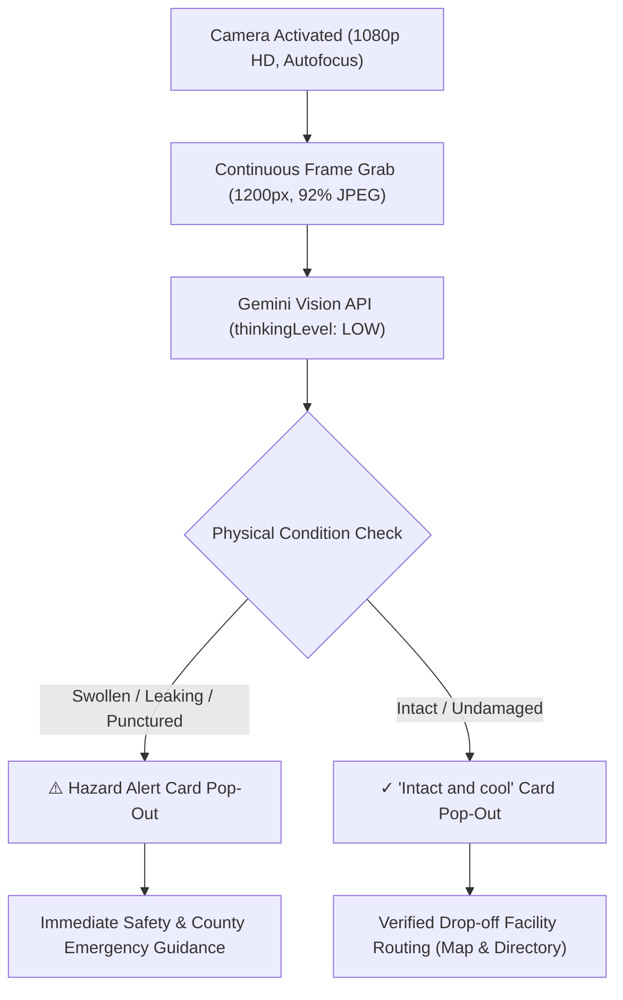

# ⚡ Watt2Do — Watt's Next? Watt2Do.

[](https://watt2do.vercel.app/)
[](https://ai.google.dev/)
[](https://developers.google.com/maps)

> **Live Web Application:** [https://watt2do.vercel.app/](https://watt2do.vercel.app/)

Watt2Do is an intelligent battery and electronic waste identification and safe disposal assistant specifically built for Hillsborough County, Florida (Tampa / USF area). It empowers residents to automatically identify battery chemistries, assess physical hazards (such as swelling, leaks, or punctures), receive immediate emergency safety guidance, and navigate to certified municipal and commercial drop-off centers.

---

## 🚀 Key Features

### 1. 🔍 Zero-Click Automatic AI Vision Scanning (`vision.py`)
- **Hands-Free Detection:** Automatically activates a continuous scanning loop that samples and analyzes camera frames without requiring manual "Capture" clicks.
- **Instant Scan Trigger ("⚡ Scan Now"):** Dedicated on-screen trigger button allowing users to immediately scan the active camera frame without waiting for timer cycles.
- **Expanded Chemistry & Markings Extraction:** Recognizes all modern chemistries including pouch cells, vape cells (`18650`, `21700`), coin cells (`CR2032`, `LR44`, `A23`, `AG13`), household cells (`Coppertop`, `MN1500`, `LR6`), tool batteries (`18V`, `20V MAX`), and lead-acid (`AGM`, `GEL`, `SLA`).
- **Sub-Second Speed (~1.0s Analysis):** Optimized with Gemini `thinkingConfig: {"thinkingLevel": "LOW"}` and balanced token limits to deliver near-instant scan responses.
- **Center Macro-Crop Processing:** Isolates the center focus zone to maximize OCR legibility on small printed battery text while keeping upload payloads lean (~100 KB).

### 2. 🛡️ Safety Condition Pop-Out Card ("Intact and cool")
- **Instant Condition Assessment:** A prominent, animated pop-out card (`@keyframes popIn`) immediately communicates battery health upon scan completion.
- **Verified Safe ("Intact and cool"):** If no physical defects are detected, the app certifies the battery as **Intact and cool**, routing the user directly to eligible drop-off locations.
- **Hazard & Damage Alerts:** If swelling, corrosion, cracks, or punctures are identified, the system immediately surfaces safety warnings, county fire protocols, and contact numbers (Hillsborough County Solid Waste: `(813) 272-5680`).

### 3. 📷 High-Clarity 1080p HUD Camera Viewfinder & Controls
- **Full HD Sensor Mode:** Requests 1080p streams (`1920x1080` ideal) to initialize macro sensors on modern smartphones and webcams.
- **Macro Zoom Toggle [ 1x | 2x Macro ]:** One-tap macro zoom switch that magnifies the center reticle (up to 48% center crop) for tiny battery text and markings.
- **Camera Flip Toggle (`🔄`):** Switch effortlessly between rear (`environment`) and front/webcam (`user`) sensors.
- **Continuous Macro Autofocus & Exposure:** Automatically configures continuous focus, auto-exposure, and white-balance capabilities via `MediaTrackCapabilities`.
- **Hardware Torch / Flashlight Toggle:** Automatically detects flashlight hardware (`caps.torch`) and provides an on-screen toggle for scanning in dim environments.
- **Mobile Camera Fallbacks:** Includes dedicated native device camera capture (`capture="environment"`) and gallery photo uploads.

### 4. 🗺️ Interactive Drop-Off Directory & Smart Mapping
- **Google Maps JavaScript API Integration:** Pins verified collection facilities with dynamic distance calculations via the Haversine formula.
- **Category & Hours Filters:** Filter locations by material type (`Batteries`, `E-waste`, `Hazardous`) and filter for locations currently open.
- **Graceful Vector Fallback:** Features a zero-crash interactive SVG map fallback if Google Maps API keys are domain-restricted (`gm_authFailure`).
- **21+ Hand-Verified Facilities:** Complete database of Hillsborough County Solid Waste / HHW facilities, Home Depot, Best Buy, Staples, Batteries Plus, and USF EHS centers.

### 5. 💬 Watty AI Assistant & Google OAuth
- **Interactive Chat Assistant:** Powered by Gemini to answer battery safety questions, explain terminal taping techniques, and direct residents to disposal rules.
- **Google Identity Services (GIS):** Seamless Google OAuth one-tap sign-in alongside instantaneous guest access mode.

---

## 🏗️ Architecture & Codebase Overview

```text
watt2do/
├── app.py                      # Flask server (port 5001): /api/scan, /api/health, dropoffs blueprint
├── vision.py                   # Gemini Vision API integration, JSON schema, & regex chemistry validation
├── dropoffs.py                 # Blueprint: GET /api/dropoffs & GET /api/maps-config
├── directory.mjs               # Node.js local recycling rules and disposal logic
├── index.mjs                   # Fast Node.js server (port 3001) proxying to Flask & Python direct
├── data/
│   └── fallback_dropoffs.json  # 21 hand-verified Hillsborough County / Tampa drop-off facilities
├── public/
│   ├── page.html               # Main single-page web app with HUD camera & condition pop-out
│   ├── screen.css              # Custom styling, dark/light themes, and popIn animations
│   └── map.js                  # Google Maps integration with gm_authFailure fallback
├── static/                     # Production static assets synced with public/
│   ├── index.html
│   ├── screen.css
│   └── map.js
├── requirements.txt            # Python dependencies (Flask, python-dotenv)
├── package.json                # Node.js configuration
├── .env.example                # Environment variable template
└── README.md                   # Project documentation
```

---

## ⚡ Quick Start

### Prerequisites
- **Node.js 20+** (for Node server) or **Python 3.10+** (for Flask backend)
- **Gemini API Key**: From [Google AI Studio](https://aistudio.google.com/api-keys)
- **Google Maps API Keys**: From [Google Cloud Console](https://console.cloud.google.com/)

### Local Setup

1. **Clone the repository:**
   ```bash
   git clone https://github.com/emmanguyen1/watt2do.git
   cd watt2do
   ```

2. **Configure environment variables:**
   ```bash
   cp .env.example .env
   ```
   Add your keys in `.env`:
   ```env
   # Gemini Vision API
   GEMINI_API_KEY=your_gemini_api_key_here
   GEMINI_MODEL=gemini-3.5-flash-lite
   MOCK_SCAN=0

   # Google Maps Platform (Browser)
   GOOGLE_MAPS_BROWSER_KEY=your_maps_browser_key_here

   # Google Places Platform (Server-only)
   GOOGLE_PLACES_SERVER_KEY=your_places_server_key_here

   # Google Identity Services
   GOOGLE_SIGN_IN_CLIENT_ID=your_oauth_client_id.apps.googleusercontent.com

   PORT=3001
   FLASK_RUN_PORT=5001
   ```

3. **Install dependencies:**
   ```bash
   npm install
   pip install -r requirements.txt
   ```

4. **Run the application:**
   - **Node.js Server (Port 3001):**
     ```bash
     npm start
     ```
     Navigate to [http://localhost:3001](http://localhost:3001) in your browser.
   - **Python Flask Server (Port 5001):**
     ```bash
     python3 app.py
     ```

---

## 🔄 Scanning & Safety Flow



---

## 🏛️ Regulatory & Public Data Sources

Safety instructions and drop-off facility details align with municipal and federal standards:
- [Hillsborough County Battery Discard Guidelines](https://hcfl.gov/residents/property-owners-and-renters/trash-and-recycling/discarding-batteries)
- [Hillsborough County Electronics & Hazardous Waste Collection](https://hcfl.gov/residents/property-owners-and-renters/trash-and-recycling/discarding-paint-and-electronics)
- [EPA Used Lithium-Ion Battery Guidance](https://www.epa.gov/recycle/used-lithium-ion-batteries)
- [The Battery Network Locator](https://locator.batterynetwork.org/)
- Commercial collection partners: [Batteries Plus Bulbs](https://www.batteriesplus.com/blog/power/battery-and-light-bulb-recycling), [Best Buy Recycling](https://www.bestbuy.com/site/services/recycling/pcmcat149900050025.c), [The Home Depot](https://www.homedepot.com/), and [Staples](https://www.staples.com/stores/recycling).

---

## 📄 License & Safety Disclaimer

Watt2Do provides location routing and AI-assisted safety recommendations for educational and waste-reduction purposes. Damaged lithium-ion batteries carry severe fire and thermal runaway hazards. If a battery is smoking, burning, or intensely hot, evacuate the area immediately and dial **911**. Always verify acceptance policies directly with facilities prior to transport.
